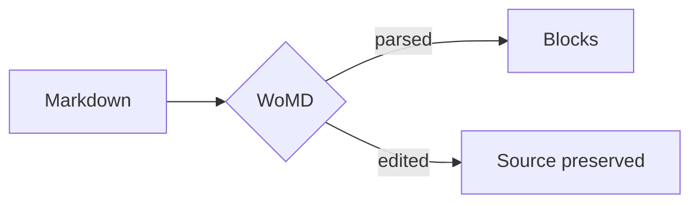
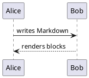

# Welcome to WoMD

WoMD is a source-preserving, Git-friendly Markdown editor. This page demonstrates the supported syntax.

## Text formatting

You can write **bold**, *italic*, `inline code`, ~~strikethrough~~, and [links](https://github.com/Data-Bike/womd).

## Lists

Unordered:
- First item
- Second item
  - Nested item

Ordered:
1. Step one
2. Step two

Task:
- [x] Completed task
- [ ] Pending task

## Tables

| Name  | Role   | Active |
| ----- | ------ | ------ |
| Alice | Editor | Yes    |
| Bob   | Review | No     |

## Code

```rust
fn main() {
    println!("Hello, WoMD!");
}
```

## Math

Inline: \( E = mc^2 \)

Display:

\[ x = \frac{-b \pm \sqrt{b^2 - 4ac}}{2a} \]

## Block quote

> Markdown is the source of truth.

## Image


## Diagrams

Mermaid:



PlantUML:



BPMN:

```bpmn
<?xml version="1.0" encoding="UTF-8"?>
<bpmn:definitions xmlns:bpmn="http://www.omg.org/spec/BPMN/20100524/MODEL" xmlns:bpmndi="http://www.omg.org/spec/BPMN/20100524/DI" xmlns:dc="http://www.omg.org/spec/DD/20100524/DC" xmlns:di="http://www.omg.org/spec/DD/20100524/DI" id="Defs_1" targetNamespace="http://example.com/bpmn">
  <bpmn:process id="p1">
    <bpmn:startEvent id="Start_1"><bpmn:outgoing>Flow_1</bpmn:outgoing></bpmn:startEvent>
    <bpmn:task id="Task_1" name="Edit block"><bpmn:incoming>Flow_1</bpmn:incoming><bpmn:outgoing>Flow_2</bpmn:outgoing></bpmn:task>
    <bpmn:endEvent id="End_1"><bpmn:incoming>Flow_2</bpmn:incoming></bpmn:endEvent>
    <bpmn:sequenceFlow id="Flow_1" sourceRef="Start_1" targetRef="Task_1"/>
    <bpmn:sequenceFlow id="Flow_2" sourceRef="Task_1" targetRef="End_1"/>
  </bpmn:process>
  <bpmndi:BPMNDiagram id="D_1">
    <bpmndi:BPMNPlane id="P_1" bpmnElement="p1">
      <bpmndi:BPMNShape id="S_1" bpmnElement="Start_1"><dc:Bounds x="100" y="100" width="36" height="36"/></bpmndi:BPMNShape>
      <bpmndi:BPMNShape id="S_2" bpmnElement="Task_1"><dc:Bounds x="200" y="80" width="100" height="80"/></bpmndi:BPMNShape>
      <bpmndi:BPMNShape id="S_3" bpmnElement="End_1"><dc:Bounds x="370" y="100" width="36" height="36"/></bpmndi:BPMNShape>
      <bpmndi:BPMNEdge id="E_1" bpmnElement="Flow_1"><di:waypoint x="136" y="118"/><di:waypoint x="200" y="118"/></bpmndi:BPMNEdge>
      <bpmndi:BPMNEdge id="E_2" bpmnElement="Flow_2"><di:waypoint x="300" y="118"/><di:waypoint x="370" y="118"/></bpmndi:BPMNEdge>
    </bpmndi:BPMNPlane>
  </bpmndi:BPMNDiagram>
</bpmn:definitions>
```

Inline SVG:

```svg
<svg xmlns="http://www.w3.org/2000/svg" width="160" height="40"><rect width="160" height="40" rx="6" fill="#88b4a2"/><text x="80" y="25" fill="#ffffff" font-size="14" text-anchor="middle" font-family="sans-serif">SVG block</text></svg>
```

## Citations

Cite entries anywhere in the text with `[@key]` — like this: [@knuth84] and [@turing36]. The bibliography lives in a fenced block:

```bibtex
@book{knuth84,
  author = {Knuth, Donald E.},
  title = {The TeXbook},
  year = {1984},
  publisher = {Addison-Wesley}
}
@article{turing36,
  author = {Turing, Alan M.},
  title = {On Computable Numbers},
  journal = {Proc. London Math. Soc.},
  year = {1936}
}
```

Change the style via the info string: ` ```bibtex ieee ` or ` ```bibtex chicago ru `.

## Thematic break

---
